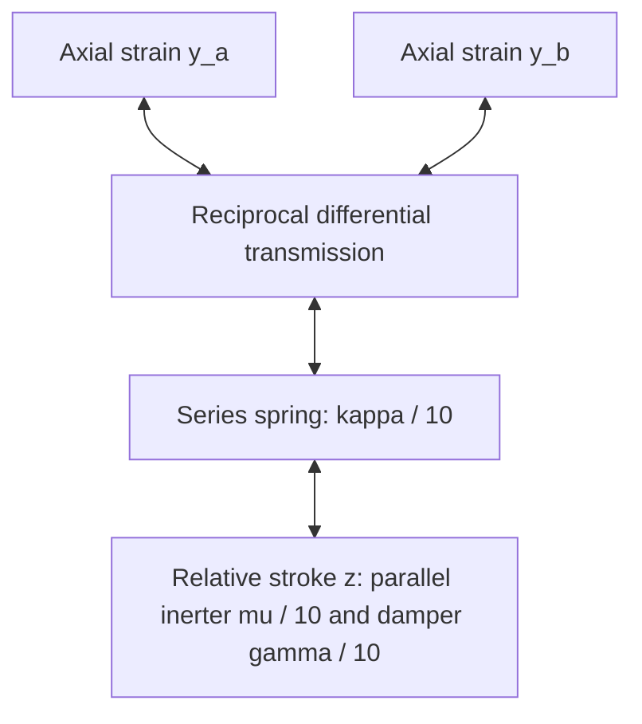

# Passive differential network with finite auxiliary dynamics — v1.0

**RESULT — An explicit reciprocal port network protects ideal common breathing and damps linear transverse motion.** A readout-selected design passes the nine declared finite nonlinear probes. It assumes ideal differential transmissions and two-terminal inertial elements; a manufactured spatial linkage, its housing masses, routing and friction remain OPEN.

Source base: `07358779cd0971dfade95b54688072f38001e342`. The [free3D mechanics](../icosahedral-free3d/README.md) and [ordinary-dashpot obstruction](../icosahedral-damping/README.md) are preserved. This introduces a different, assumed constitutive network. No native UD or physical promotion follows.

## 1. Reciprocal building block

Let y_a,y_b be dimensionless actual axial strains on two members. A lossless differential transmission has output d=y_a-y_b and returns its output force F to the inputs as conjugate resisting forces (+F,-F). Its kinematic and force ratios must be reciprocal. With a ratio error delta, use d=y_a-(1+delta)y_b and return (+F,-(1+delta)F). Using a sensor difference without the reciprocal reaction would define another model and would not establish passivity.



This diagram represents power ports, not an electronic feedback controller. At the output, a spring in series with the parallel combination of an inerter and damper gives

$$F=\frac{\kappa}{10}(d-z),\qquad \frac{\mu}{10}\ddot z+\frac{\gamma}{10}\dot z=F.$$

The internal variable z is relative stroke across a **two-terminal inerter**, not the absolute displacement of a mass fixed to an external reference. The port's return terminal moves with the assembly; there is no mechanical-ground attachment in the ideal model. An ideal inerter stores energy in relative velocity. Smith's primary treatment defines this element and discusses rack/pinion/flywheel realizations; it does not establish the present icosahedral transmission layout [S1].

For one branch,

$$E_{\rm br}=\frac{\mu}{20}\dot z^2+\frac{\kappa}{20}(d-z)^2,\qquad \dot E_{\rm br}=F\dot d-\frac{\gamma}{10}\dot z^2.$$

A common input y_a=y_b produces no output d. Positive component values and finite mu,kappa are retained; this is not an instantaneous damping projection. Ideal transmissions, sufficient travel and negligible parasitic common-port impedance are assumptions, not derived material properties.

## 2. Local comparison topology and counts

Keep the parent's40 coordinates x=(alpha,C,X_1,...,X_12), potential U0 and mass M. Its42 measured strains are12 radial s_i=|X_i-C|/R-1 and30 ordinary edge e_ij=|X_i-X_j|-1, with reference edge a=1 and R²=(5+sqrt5)/8.

| Comparison carrier | Inputs | Local pair rule | Branches | Exact incidence rank |
| --- | ---: | --- | ---: | ---: |
| Radial graph | 12 radial strains | Compare neighboring shell vertices | 30 | 11 |
| Edge line graph | 30 shell-edge strains | Compare edges sharing a vertex | 12 choose(5,2)=120 | 29 |

Each pair has one auxiliary z and velocity. Total configuration dimension40+150=190; phase dimension380. One additional scalar records dissipated energy. These mechanical dimensions are distinct from chain-register dimensions and face counts.

Orient each input pair by its sorted indices. Reversing that orientation also reverses z. Uniform component values preserve the parent's spatial symmetries through signed permutations of branch variables. Normalization1/10 is an explicit engineering choice applied equally to spring, inertance and damper; it is not a UD-derived coefficient.

Let G be the150-by42 block incidence matrix, y(x) the measured strains, d=Gy(x), and J=partial d/partial x. The coupled equations are

$$M\ddot x+\nabla U_0(x)+\frac{\kappa}{10}J(x)^T(d-z)=0,$$
$$\mu\ddot z+\gamma\dot z+\kappa(z-d)=0.$$

Returned tensions act along the actual radial and edge members. Every force on a spatial endpoint has its opposite reaction on the other endpoint. Radial reactions include the moving centre C. The code applies these endpoint forces directly, rather than anchoring a hub or prescribing radial guides.

## 3. Exact passivity, kernel and protected breathing

The total mechanical energy is

$$E=\tfrac12\dot x^TM\dot x+U_0(x)+\frac{\mu}{20}\|\dot z\|^2+\frac{\kappa}{20}\|d-z\|^2,$$
$$\dot E=-\frac{\gamma}{10}\|\dot z\|^2\le0.$$

The primary system supplies power minus F^T d_dot to the network. This cancels the branch input power above. Spatial linear and angular momenta remain conserved because all endpoint reactions are central. Auxiliary relative inertance is represented by its port energy; the physical casing/flywheel translational masses are not separately represented.

Integer graph certificates give Laplacian spectra:

- Radial:0(1),6(5),(5+sqrt5)(3),(5-sqrt5)(3).
- Edge line graph: the same roots/multiplicities plus10(18).

Connectivity, square-free annihilating polynomials and exact traces verify these spectra. At the reference geometry the edge-only derivative has exact rank29; combining radial differences gives rank32 over Q(sqrt5). The exact eight-dimensional kernel is six rigid motions plus the internal alpha coordinate and uniform spatial scale. An explicit independent kernel basis is checked, not inferred from floating singular values.

On the homothetic family C=0,X_i=(1+b)r_i, all radial strains and all edge strains equal b. Thus d=0 at every amplitude for which lengths remain positive. With z=zdot=0, every auxiliary stays zero and the parent's **undamped** collective equations remain exactly

$$\ddot\alpha+13\alpha-12b=0,\qquad \ddot b+3b-\alpha=0.$$

Their frequency squares remain8±sqrt37. Equal-input cancellation holds branch by branch even if positive component values differ; mechanical mass/spoke imperfections and transmission-ratio errors are separate sources of symmetry breaking.

**Linear stability theorem, conditional on default mechanical symmetry and ideal ratios.** Remove the six rigid and two collective coordinates. The total quadratic energy on the remaining32 primary plus150 auxiliary coordinates is positive definite. An imaginary-axis mode with nonzero frequency would have zero dissipation, hence zdot=0 and z=0. The auxiliary equation then forces Jx=0. Its exact kernel contains only collective/rigid directions, which are absent in the transverse subspace. A zero eigenvalue is excluded by positive stiffness. Positive energy prevents unstable poles. Therefore every transverse pole has strictly negative real part for all positive mu,kappa,gamma. This is a local equilibrium linearization theorem, not all-time attraction to finite-amplitude breathing.

The earlier length-domain certificate also survives: added branch energy is nonnegative and initially zero. For the previous ±5% g,k box, initial undeformed points,alpha=A0,zero velocities, |A0|<sqrt(19/680) prevents spoke/edge collapse for all time. This does not certify orientation, convexity or coherence. The A0=.2 probes exceed this bound.

## 4. Finite port response and design selection

With s the Laplace variable, define mechanical impedance here as force/relative velocity:

$$Z(s)=\frac{\kappa}{10}\frac{\mu s+\gamma}{\mu s^2+\gamma s+\kappa},$$
$$\operatorname{Re}Z(i\omega)=\frac{\kappa^2\gamma}{10[(\kappa-\mu\omega^2)^2+\gamma^2\omega^2]}>0.$$

Smith [S1] uses the reciprocal impedance/admittance naming convention. Our formula follows directly from this branch's equations. Finite compliance and inertia shape the useful frequency band; replacing them by a projected dashpot would discard the internal modes and their response.

[PROTOCOL.md](PROTOCOL.md) records Phase A's initial27-point pole-decay selection. It failed the finite coherence screen. [AMENDMENT_v1.1.md](AMENDMENT_v1.1.md) records the exposed outcome and Phase B's additional27-point pulse-readout selection. There were54 evaluations and53 distinct parameter triples. Both phases and all tested values are preserved. Nine nonlinear preparations reuse three exposed ±5% property realizations at A0=.025,.1,.2; there is no held-out predictive claim or tolerance-box guarantee.

For Phase B, uniform branch parameters permit an exact linear reduction to the32-dimensional image of J. The other118 auxiliary combinations are unforced from zero and obey their own stable homogeneous equations. All34 primary nonrigid coordinates are retained, including disorder-induced collective/shape mixing. The reduced linear pulse is checked against the full380-phase linearized equations; the subsequent nonlinear simulations retain all150 auxiliaries.

See [RESULTS.md](RESULTS.md), [candidate](../../candidates/icosahedral-multiport/candidate.json), [mathematical receipt](../../candidates/icosahedral-multiport/mathematical_receipt.json) and [immutable run](../../artifacts/icosahedral-multiport-20261022-a1/multiport-001/manifest.json).

## 5. Reproduction and physical scope

```bash
OPENBLAS_NUM_THREADS=1 python3 experiments/icosahedral-multiport/exact.py --out /tmp/multiport
OPENBLAS_NUM_THREADS=1 python3 experiments/icosahedral-multiport/analyze.py --out /tmp/multiport
OPENBLAS_NUM_THREADS=1 python3 experiments/icosahedral-multiport/readout_design.py --out /tmp/multiport
OPENBLAS_NUM_THREADS=1 python3 experiments/icosahedral-multiport/frequency.py --out /tmp/multiport
python3 experiments/icosahedral-multiport/draw.py --source /tmp/multiport --out /tmp/multiport/multiport-summary.png
```

Nonlinear DOP853 uses2001 samples,u0..100,rtol1e-10,atol1e-12. Selected worst-mismatch refinements use4001 samples,rtol2e-12,atol2e-14. Source/input bytes, grids, amendment, properties, outputs and figure are captured.

All quantities use u=t/t0, position scale ell0 and energy E_*. Taking physical output stroke ell0*d gives branch spring stiffness E_*kappa/(10ell0²), inertance E_*t0²mu/(10ell0²), and damper coefficient E_*t0*gamma/(10ell0²). Transmissions supply the fixed input normalizations for radial/edge strains. These scales are OPEN, not measured calibrations.

The current object is a conditional mechanical port realization with explicit finite internal dynamics and reciprocal spatial reactions. Hardware feasibility still requires the differential linkage/routing, finite casing mass, travel limits, parasitic friction, calibrated ratios and a physical readout. The independent-loss obstruction is preserved; the new network changes its hypotheses. This construction does not select a native UD constitutive law or spacetime map.

[S1] M. C. Smith, “Synthesis of Mechanical Networks: The Inerter,” IEEE Transactions on Automatic Control47(10),1648–1662(2002), DOI10.1109/TAC.2002.803532, §II.C and conclusion. [Author's primary-source PDF](https://www-control.eng.cam.ac.uk/foswiki/pub/Main/MalcolmSmith/cued_control_859.pdf), retrieved2026-10-22. Imported for the two-terminal inertance element and its ideal-model scope; the comparison topology and parameters here are newly assumed/derived.
