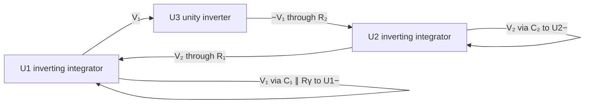

# AW5 two-state signed integrator pair

**CANDIDATE CIRCUIT / EXACT CONDITIONAL CALIBRATION BOUND. Physical Promotion = 0.** This is a circuit specification and synthetic unit test. Hardware gates remain open.

## Circuit and normalization

Let x₁ be the face voltage and x₂ the adjacent-grade voltage, each divided by the same fixed voltage scale. Let native time t = t_bench/τ with τ = 1 ms. Use the nominal generator G★ = [[−γ★, −1], [1, 0]] with γ★ = 1/1024. Measure both outputs independently, using high-impedance calibrated taps and a common impulse reference.

| Element | Connections and nominal design values |
| --- | --- |
| U1 and U2 | Noninverting inputs to a common analog reference. Each output returns through its feedback capacitor to its own inverting input. |
| R₁, C₁ | V₂ to U1− through 100 kΩ. U1 feedback capacitor 10 nF. This contributes −V₂/(R₁C₁). |
| U3, R₂, C₂ | U3 inverts V₁ with equal input and feedback resistors, nominally 10 kΩ each. U3 output to U2− through 100 kΩ. U2 feedback capacitor 10 nF. This contributes +V₁/(R₂C₂). |
| Rγ | Optional parallel U1 feedback resistor sets −V₁/(RγC₁). The ideal equivalent value at γ★ is 102.4 MΩ. A calibrated current proportional to V₁ can implement the same nominal term. |
| Reset and injection | Provide a capacitor reset and a separately controlled signed charge injection at each summing node. Open the reset during each shot. Calibrate the realized start state at the common post-injection reference plane. |

The U2 feedback capacitor is the ideal specification. Op-amp bias and offset, board leakage, reset/injection transients, inverter bandwidth, and intentional bleed enter the effective generator or initial-state uncertainty. A common stabilizing bleed is permissible if it is charged to the operator budget and included in the damping inference. The dimensionless face-selective damping estimate is γ̂ = Ĝ₂₂ − Ĝ₁₁ under the declared common-bleed plus face-loss model. Without that structure the diagonal contrast is still measurable and its decomposition into loss sources remains open. The high-value feedback element is a design-equivalent value. Leakage calibration is required before claiming a selectable γ.

Reference circuit principle and offset discussion: [TI integrator circuit, SBOA275B](https://www.ti.com/lit/an/sboa275b/sboa275b.pdf).

## Basis-injection protocol

1. Freeze the nominal polarity, voltage scale, τ, sample interval h = 1/8 native units, amplitude range, certificate rules and held-out preparations. The corresponding bench interval is 125 µs. Start with ±250 mV about the reference as an adjustable prototype amplitude. Check for clipping and amplitude-dependent response.
2. Run interleaved +e₁, −e₁, +e₂, −e₂ and zero-input shots, with both outputs sampled at the effective initial time and at h. Form the half-difference for each sign pair. Store the two initial columns in X̂ and the endpoint columns in Ŷ. Equal affine offsets cancel in the half-difference. Measure residual drift and include it in the uncertainty bounds.
3. Certify induced 2-norm bounds δX and δY on the initial and endpoint matrix errors. Include gain and bias, anti-alias response, loading, aperture and clock error, and any departure from a common LTI generator during calibration. A sufficient matrix bound from entrywise uncertainties is their Frobenius norm. If the one-step LTI representation cannot be supported over the scope, hold the generator certificate.
4. Compute M̂ = Ŷ X̂⁻¹ and use the principal logarithm Ĝ = log(M̂)/h. If σ_min(X̂) ≤ δX, repeat with a better-conditioned preparation. Check the near-identity radius and propagate uncertainty as below.
5. On held-out mixed and changed-amplitude preparations, compare both state trajectories to the identified model over the calibration interval and across the full 32-unit window. Record residuals, sign, drift, timing loopback, and zero-input results. Held-out replay screens the declared model scope. The independent error bounds supply the certificate.

## Uncertainty propagation and acceptance

For the true M = exp(hG), let Y = MX. If σ_min(X̂) > δX, then

$$\|\widehat M-M\|_2 \le \epsilon_M =
\frac{\delta_Y+\|\widehat M\|_2\delta_X}{\sigma_{\min}(\widehat X)-\delta_X}.$$

This follows by solving (M̂−M)X = (Ŷ−Y) − M̂(X̂−X). Check an independently justified native ||G||₂ ≤ 3/2 on the two-state scope. Then ||hG||₂ ≤ 3/16 and ||M−I||₂ < 1/4. Require ||M̂−I||₂ + ε_M ≤ 1/4 as a check on the acquisition. The logarithm power series and the telescoping difference of powers bound the generator uncertainty by

$$\rho = \frac{\epsilon_M}{h(1-1/4)}=\frac{32}{3}\epsilon_M,qquad
\|\widehat G-G\|_2\le\rho.$$

Inflate computed norm and log bounds for numerical error in a hardware certificate. The rate conversion uses the calibrated interval; incorporate interval uncertainty through the endpoint error budget or explicitly bound its contribution to the generator, with no double counting. For example, assigning 1/8192 of native generator norm to identification uncertainty requires ε_M ≤ 3/262144, about 11.4 ppm in transition norm. The scorer-level 0.977 µs timing allowance does not by itself certify this endpoint budget. At this speed, an endpoint clock error acting alone under ||G||₂ ≤ 3/2 and contractivity would use that entire illustrative map allowance at about 7.6 ns.

| Gate | Sufficient decision criterion |
| --- | --- |
| Generator | ||Ĝ−G★||₂+ρ ≤ 1/4096. |
| Supported signed coefficients | For each off-diagonal entry, absolute error from its signed unit target plus ρ ≤ 1/49152 for the selected full-carrier coefficient allocation. |
| Dissipativity | λmax(sym Ĝ)+ρ ≤ 0. If an ideal zero-loss direction prevents an uncertainty-robust pass, account for a measured dissipative guard in the generator budget. |
| Selective loss | [γ̂−2ρ, γ̂+2ρ] lies inside [0,1/512] for the common-bleed plus face-loss model. |
| Timing and scope | Independent timing loopback and endpoint uncertainty receipts, healthy injection rank, model-scope checks, and retained held-out residuals. |

The pair is an engineering unit test. Full-carrier certification still needs operator-level error, dissipativity, damping, channel and noise evidence in the shared coordinate basis.

The synthetic replay checks both signs and certificate outcomes for a guarded nominal pair, a reversed sign, and a gain error. No physical trace was supplied. The merge receipt for UD PR #516 is c48ffb8b2f9c82b33bcd25fc24755d16c0053424. Transfer to the named WBS v2.7 manifest remains pending location of that register.

## Run footer

- **Mission** — Specify the signed pair and an uncertainty-aware calibration before AW5 replication.
- **Done** — Derived the circuit polarity, basis-injection identification and explicit operator certificate gates.
- **Finding** — Coefficient certification requires a tighter endpoint budget than the scorer's timing tolerance alone supplies.
- **Bridge value** — An auditable calibration candidate is available. Hardware evidence and independent review remain open.

## Next step

1. **Priority 92/100** — Bench the signed pair with the proposed timing loopback and held-out preparations, then evaluate the uncertainty certificate before scaling.
