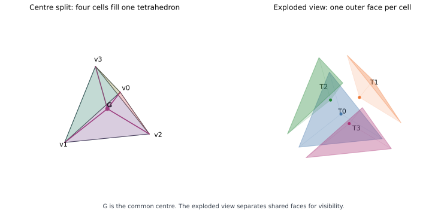

# Four cells filling a tetrahedron — Discovery analysis v1.0

## Definition and scope

Let T=[0123] be a filled regular tetrahedron, g its centroid (vertex 4), and K=g*boundary(T). The four maximal cells are [0124], [0134], [0234], [1234]. Every simplex uses ascending vertex orientation. This is the centre insertion/1->4 Pachner construction, not four half-size corner tetrahedra. Centre insertion is standard; its significance for a UD physical model is a separate candidate question.

Calculations below are EXACT for this finite complex. Geometry uses rational coordinates v0=(1,1,1), v1=(1,-1,-1), v2=(-1,1,-1), v3=(-1,-1,1), g=(0,0,0). Chain operators use the explicitly chosen unweighted metric H=I over the reals, not a volume/edge-weighted physical metric. Model evolution is dz/du=A z for arbitrary initial coordinates and dimensionless model parameter u; no physical clock or material coupling is supplied.

## Exact sharing, geometry and recursive counts

- Each cell has one unshared exterior face and three faces shared with the other three cells. Thus the cell-adjacency graph is K4, just as the parent vertex graph is K4. These are different typed graphs with a correspondence, not an identity of their states.
- The 16 cell-face incidences comprise 4 exterior incidences and 12 paired interior incidences. There are 6 distinct shared faces.
- The face vector is (V,E,F,T)=(5,10,10,4); Euler characteristic is 1. Boundary ranks are (4,6,4), so Betti numbers over the reals are (1,0,0,0).
- Each child volume is V_parent/4. For outer edge length a, a radial edge has length sqrt(3/8)*a. Each child therefore has three edges of length a and three of length sqrt(3/8)*a; it is not regular or similar to the parent.
- Each inner triangular face has area A_outer/sqrt(6). The 1/4 exterior-face count fraction is not the cell's exterior-area fraction: the latter is 1/(1+3/sqrt(6)). Count fractions do not automatically weight energy, flux or physical exposure.

Repeat centroid insertion inside every cell. With N_n=4^n, elementary insertion counts give

$$V_n=(4^n+11)/3,\quad E_n=(4^{n+1}+14)/3,\quad F_n=2\,4^n+2,\quad T_n=4^n.$$

The outer boundary remains the original four triangles. Each insertion adds (1,4,6,3) to the face vector; summing the geometric series proves the formulas. Every descendant has volume V_parent/4^n. The rule repeats locally relative to each parent, but only four cells touch the original exterior by a face at each depth n>=1; at depth 2, four of 16 cells have one exterior face and the other 12 are entirely interior by faces.

This is a recursive combinatorial/affine subdivision. It is not strict metric self-similarity of regular copies. In the given coordinates the map replacing vertex i by g while fixing its opposite face has linear part M_i=I-v_i v_i^T/4. Its eigenvalues are (1,1,1/4), determinant 1/4, and it fixes a full triangle. It is not a strict contraction in Euclidean distance. Repeated boundary descendants retain the same face/edge while their height falls as 4^(-n); shrinking volume does not make this a uniform, shape-regular refining mesh.

The filled union remains the solid tetrahedron, of Hausdorff dimension 3. A conventional four-half-size-corner construction instead leaves a central octahedral gap of half the parent's volume; its cells meet at vertices rather than sharing the specified faces. Removing that gap recursively is a different Sierpinski-type construction.

## Exact relative-chain duality

The outer-boundary chain counts are (4,6,4,0), dimension 14. The relative chains C_*(K,boundary K), represented by the simplices containing g, have counts (1,4,6,4), dimension 15. The parent counts are (4,6,4,1), also dimension 15. Total chains have dimension 29=14+15.

Dimension equality is only the starting observation. Here an explicit signed complement map verifies the relationship. For S a proper subset of {0,1,2,3}, q=|S|, set

$$P[e_{S^c}]=(-1)^{q(q+1)/2}\,\epsilon(S,S^c)\,e_{S\cup\{4\}},$$

where epsilon is the sign of the concatenated ordered word (S,S^c). This reverses chain degree: parent degree 3-q maps to relative degree q. Under the ascending bases, P is a 15x15 signed permutation matrix.

Let A have B_k in the upper adjacent-grade blocks and -B_k^T in the lower blocks. Exact integer multiplication verifies

$$PP^T=I,\qquad A_{rel}=P A_T P^T.$$

Thus the declared relative model is isometric to the parent linear model at the same model parameter, and both have characteristic polynomial lambda*(lambda^2+4)^7. Under S4 the correspondence includes the orientation character: rho_rel(h)P=sign(h)P rho_T(h), verified for all 24 permutations. Equal spectra do not license ignoring this representation twist.

## Why the full dynamics is different

Relative homology/chain construction is well-defined. Its Hodge/skew generator with the chosen relative metric is not automatically the quotient dynamics of the full skew generator: the outer-boundary subspace is not invariant under the full generator's adjoint coupling.

The actual boundary-interior coupling block has rank 14. In coherently oriented cell coordinates, the interior-face Gram matrix is 4I-J, while including each cell's outer face gives 5I-J, with J the all-ones 4x4 matrix. Their eigenvalues are respectively (0,4,4,4) and (1,5,5,5). This is an exact boundary-induced shift in the stated unit-metric operator, not an experimentally measured restoring force.

For the full 29-dimensional generator,

$$\chi_{A_K}(\lambda)=\lambda(\lambda^2+1)(\lambda^2+5)^{13}.$$

The executable certificate sets M=-A_K^2 and checks M(M-I)(M-5I)=0, tr(M)=132, tr(M^2)=652 and rank(M)=28 using exact integers/rational elimination. Since M is real symmetric, its eigenvalues are confined to {0,1,5}; the traces fix multiplicities (1,2,26). Skew eigenvalues pair, giving the stated characteristic polynomial.

The full model has active frequency families 1 and sqrt(5), so it has no universal nonzero return time. States/observables restricted to one family may still recur. The parent/relative model has the single active frequency 2. Therefore the exact relative duality cannot be promoted to unrestricted full-system self-similar dynamics without an explicit boundary/readout/coarse-graining law.

## Verification and interpretation

Run `python3 experiments/four-cell-tetrahedron/analyze.py`. It checks boundary composition, ranks, sharing, volumes/lengths/areas, duality and symmetry maps, spectral polynomial identities, and recursive counts through depth 2. It prints the signed map and complete result record. No symbolic library is required. `draw.py` renders the exact-coordinate schematic with matplotlib/numpy; plotting is illustrative rather than proof.

EXACT: finite geometry/combinatorics and conditional unit-metric operator identities. CANDIDATE: a recursive UD module and a possible coarse-graining programme. OPEN: source-selected geometric weights, boundary closure, physical time/units, coupling and observable selection. No physical correspondence is established.

Next discriminant: specify a boundary/readout map and derive its effective generator or transfer operator; test whether a nontrivial parent/child relation survives gluing rather than merely boundary removal.

## External references

- Benjamin Burton, *The Pachner graph and the simplification of 3-sphere triangulations*, arXiv:1011.4169, Section 2/Figure 2, describes the 1->4 centre-vertex move. https://people.smp.uq.edu.au/BenjaminBurton/papers/burton11-pachner-scg.pdf
- John Baez, Quantum Gravity Seminar Fall 2000, week 10 notes, describes centre insertion. https://math.ucr.edu/home/baez/qg-fall2000/qg10.2.html
- UCLA CAM report 91-01, tetrahedral refinement discussion: four half-size corner tetrahedra and a central octahedron. https://ww3.math.ucla.edu/camreport/cam91-01.pdf

The calculations and complement/intertwining certificate above are reproduced here under their declared definitions; external references identify the known construction, not a new physical UD result.
