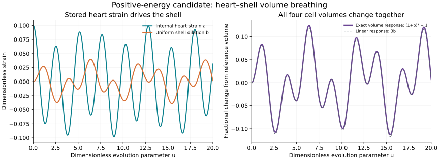

# Positive-energy heart–shell volume response — v1.0

Evidence: HYPOTHESIS for the chosen mechanical law and internal variable; CONDITIONAL/EXACT for the derived response and stability. This is a separate scalar/radial Discovery model, not a consequence of the existing29-dimensional incidence generator and not a native UD or empirical material identification.

## 1. Define the heart variable and geometric readout

The carrier is the four-cell cone with shared vertex0 and outer vertices1,2,3,4. Its primal graph is K5 and its interior cell graph is K4, as established in [the K5 analysis](../k5-four-cell/README.md). The prior [heart-mode analysis](../heart-shell-modes/README.md) shows why the chain generator alone does not transfer a heart-vertex amplitude into cell/face amplitudes or geometric breathing. The model below explicitly adds different state variables and a constitutive law; it does not evade that scoped obstruction by relabelling a chain coordinate.

Let a be a dimensionless internal preferred radial strain stored at the heart. It is neither displacement of the centre point, nor automatically pressure, positive stock or a native carrier amplitude. Let q_i be the dimensionless radial displacement strain of outer vertex i. With centre fixed at0, choose reference positions

$$r_1=L(1,1,1),\quad r_2=L(1,-1,-1),\quad r_3=L(-1,1,-1),\quad r_4=L(-1,-1,1)$$

and actual outer positions R_i=(1+q_i)r_i. Require q_i>-1. Each vertex stays on its reference ray; angular/shear degrees of freedom are excluded. The heart remains inside the convex hull for these positive radial scales. Reference total volume is V0=8L^3/3.

For the cell opposite vertex i, determinants give the exact readout

$$V_i(q)=\frac{V_0}{4}\prod_{j\ne i}(1+q_j),\qquad V(q)=\sum_i V_i(q).$$

Opposite-vertex indexing is not the original drawing's Cell1–Cell4 order. No equality between oriented chain amplitudes and these unsigned geometric volumes is assumed.

## 2. A positive kinetic and potential energy

Use a dimensionless evolution parameter u and positive generalized inertias I_h,I_s. With primes denoting d/du, define

$$T=\frac{I_h}{2}(a')^2+\frac{I_s}{2}\sum_i(q_i')^2,$$

$$U=\frac{K_h}{2}a^2+\frac{K_s}{2}\sum_i q_i^2+\frac{K_c}{2}\sum_i(q_i-a)^2+\frac{K_t}{2}\sum_{i<j}(q_i-q_j)^2.$$

Choose I_h,I_s,K_c>0 and K_h,K_s,K_t>=0 with K_h+K_s>0. The first two terms provide a preferred undeformed state; K_c couples the internal heart to each outer radial strain; K_t penalizes differences between outer radial strains. This law is chosen, not uniquely selected by the tetrahedral graph. K_t is a scalar strain-difference stiffness, not automatically the stiffness of six physical edge springs.

All strains and u are dimensionless. I_h,I_s and the K coefficients have energy units (or a declared model energy unit); E=T+U is energy within this chosen model. If u=t/t0 is later calibrated, physical generalized inertias are I_h*t0^2 and I_s*t0^2, and angular frequencies are omega/t0. For actual point masses m constrained to the radial rays, I_s=3mL^2/t0^2. No m,L,t0 or energy scale is inferred from UD combinatorics here.

The state is (a,q_1,...,q_4,a',q_1',...,q_4') in R10 within the geometric domain. Conservative equations follow from T-U. Arbitrary initial states are permitted subject to the domain; no external forcing or damping is present in the core model. The positive energy controls stability within this restricted ansatz, not unconstrained three-dimensional elasticity or an independently verified native mechanism.

## 3. Collective and differential equations

Write b=(sum_i q_i)/4 and d_i=q_i-b, so sum_i d_i=0. Then

$$U=\frac{K_h}{2}a^2+2K_s b^2+2K_c(b-a)^2+\frac{K_s+K_c+4K_t}{2}\sum_i d_i^2,$$

$$T=\frac{I_h}{2}(a')^2+2I_s(b')^2+\frac{I_s}{2}\sum_i(d_i')^2.$$

The factor4 in the differential term follows from sum_(i<j)(d_i-d_j)^2=4sum_i d_i^2 on the zero-sum subspace. It is a four-port graph count, not a physical coefficient imported from elsewhere.

The exact collective equations are

$$I_h a''+(K_h+4K_c)a-4K_c b=0,$$

$$I_s b''+(K_s+K_c)b-K_c a=0.$$

The three independent differential modes obey

$$I_s d_i''+(K_s+K_c+4K_t)d_i=0,\qquad\sum_i d_i=0.$$

Thus the symmetric initial/forcing sector d_i=d_i'=0 remains invariant exactly. A heart preparation alone drives only collective shell motion under these symmetric coefficients; generic initial differential perturbations persist as separate modes. Symmetry-breaking coefficients require a new calculation.

Define A=(K_h+4K_c)/I_h, B=(K_s+K_c)/I_s. The two collective squared angular frequencies are

$$\omega_\pm^2=\frac12\left[A+B\pm\sqrt{(A-B)^2+\frac{16K_c^2}{I_hI_s}}\right],$$

and the differential triplet has

$$\omega_d^2=\frac{K_s+K_c+4K_t}{I_s}.$$

Both collective modes involve a and b when K_c!=0. The shell restoring energy turns the previous scalar-port model's free common mode into a second collective oscillator. The frequencies and their ratios depend on the assumed stiffnesses/inertias; no universal ratio is asserted. K_t changes the differential triplet while leaving both collective frequencies unchanged within this model family.

## 4. Positivity, stability and geometric validity

U is positive definite under the stated nonnegative coefficient assumptions: if all its nonnegative terms vanish, the K_c term sets all q_i=a, and at least one nonzero pinning coefficient sets a=q_i=0. Positive inertias make E a positive quadratic form on the full phase space. E is conserved, so the equilibrium is Lyapunov stable and all linear state trajectories are bounded. The conservative equilibrium is not attracting.

Equivalently, the collective determinant is

$$D_0=(K_h+4K_c)(K_s+K_c)-4K_c^2=K_hK_s+K_hK_c+4K_cK_s>0.$$

The normalized collective trace is positive and the discriminant is nonnegative; both omega_pm squared are positive. The collective stiffness in (a,b) is [[K_h+4K_c,-4K_c],[-4K_c,4(K_s+K_c)]] and the mass matrix is diag(I_h,4I_s). Keeping these factors4 is necessary for energy consistency.

A geometric collapse is excluded locally by the same energy bound. If K_s>0 and E(0)<K_s/2, then |q_i(u)|<=sqrt(2E(0)/K_s)<1 for every i, ensuring q_i>-1 for all model times. This is sufficient, not necessary. Positivity/stability of the unrestricted linear coordinates alone would not guarantee the geometric domain for arbitrarily large preparations.

If K_h=K_s=0, the common mode is free and a nonzero common velocity drifts, as in the previous unpinned model. If K_c=0, the heart and shell decouple. Those are discriminating baselines, not failures of the positive pinned case.

## 5. The actual volume response and a conjugate pressure

For a collective trajectory q_i=b,

$$V_i(u)=\frac{V_0}{4}[1+b(u)]^3,\qquad V(u)=V_0[1+b(u)]^3.$$

For an initial internal strain a(0)=a0 with all shell strains and all velocities zero,

$$b''(0)=\frac{K_c}{I_s}a_0,\qquad V''(0)=3V_0\frac{K_c}{I_s}a_0.$$

Thus positive a0 produces an initially expanding shell, with all four cells changing volume together. Stored initial energy supplies the motion; the centre point does not move.

The coupling contribution has a well-defined pressure conjugate to collective volume:

$$p_c=-\left.\frac{\partial U_c}{\partial V}\right|_a=\frac{4K_c(a-b)}{3V_0(1+b)^2},\qquad U_c=2K_c(b-a)^2.$$

This is an energy-derived model pressure with units energy/volume. It is not the supplied ledger's phase/holonomy precursor or an already sourced UD pressure stock. The total restoring force also contains the K_s term.

For nonuniform radial modes, the exact total readout is

$$\frac{V}{V_0}=(1+b)^3-\frac{1+b}{4}\sum_i d_i^2+\frac1{12}\sum_i d_i^3.$$

In particular delta V_i=V0*(3b-d_i)/4 and delta V=3V0*b to first order. Differential radial strains preserve total volume only to first order. For example d=(delta,-delta,0,0), b=0 gives V/V0=1-delta^2/2. This differs from moving the heart inside a strictly fixed shell, whose total volume is exactly constant. Nonlinear readout terms do not imply nonlinear energy transfer between the decoupled oscillator sectors.

## 6. Forced response and static stiffness

Add a generalized force F_h(u) conjugate to a. For a small harmonic force of angular frequency omega, no damping, and zero differential forcing, the linear volume susceptibility away from resonant poles is

$$\frac{\delta V(\omega)}{F_h(\omega)}=\frac{3V_0K_c}{(K_h+4K_c-I_h\omega^2)(K_s+K_c-I_s\omega^2)-4K_c^2}.$$

This states a concrete heart-to-volume prediction conditional on the model. At an undamped resonant pole, a bounded stationary harmonic response is not supplied by this formula. Inferring parameters from a future volume trace is an inverse problem, not a native derivation.

Minimizing U over a at each fixed b is a static equilibrium calculation, not a derived dynamical elimination. It gives shell stiffness in b equal to 4D0/(K_h+4K_c), hence model bulk modulus at equilibrium

$$B_{\rm eff}=\frac{4D_0}{9V_0(K_h+4K_c)}>0.$$

It is the second derivative of the relaxed energy with respect to volume, multiplied by V0. It is not inferred from the bare K5 graph.

Optional damping coefficients Gamma_h,Gamma_s>=0 can be added as forces -Gamma_h*a' and -Gamma_s*q_i'. With external forces F_h,f_i, the balance is

$$E'=F_h a'+\sum_i f_i q_i'-\Gamma_h(a')^2-\Gamma_s\sum_i(q_i')^2.$$

This follows by multiplying the equations by velocities; it does not select the coefficients or a material dissipation mechanism. Strictly positive damping on all these velocities gives asymptotic relaxation for the positive stiffness. Damping only the heart leaves the decoupled differential triplet undamped. No active autonomous pumping or sustained selected amplitude follows from positive conservative energy or passive damping alone.

## 7. Exact illustrative preparation

Choose, for illustration only,

$$(K_h,K_s,K_c,K_t,I_h,I_s)=(1,1,1,1/2,1,1),\qquad a_0=1/10.$$

These convenient model-unit choices are not fitted physical constants, privileged UD fractions or a prediction of the native theory. They give omega_minus squared=1, omega_plus squared=6, omega_d squared=4. Two independent exact collective mode vectors (a,b) are (1,1) and (4,-1).

With all other initial coordinates and velocities zero,

$$a(u)=\frac{a_0}{5}\,[\cos u+4\cos(\sqrt6\,u)],$$

$$b(u)=\frac{a_0}{5}\,[\cos u-\cos(\sqrt6\,u)].$$

All four cell volumes follow V0*(1+b)^3/4 exactly. The initial energy is1/40; |b|<=2|a0|/5=1/25, so the example stays inside the geometric domain. The collective frequencies1 and sqrt(6) are incommensurate, so the prepared full trajectory is not periodic. Isolated crossings of the initial volume still occur and do not constitute full state return. No physical clock period is claimed.

## 8. Verification, provenance and next discriminant

Run `python3 experiments/heart-shell-elastic/analyze.py`. It verifies exact parameter-coefficient mass/stiffness decompositions (therefore all parameters in the declared family), four rational full5x5 polynomial determinants and Hamiltonian energy identities, all24 S4 permutations for the example, exact mode vectors/initial decomposition, rational determinant volumes, the nonlinear volume identity and the zero-coupling/unpinned baselines. No numerical eigensolver or ODE integrator is used. The report proves positivity and the analytic response; finite rational examples check implementation rather than replace the general proof. `draw.py` samples the exact prepared solution for illustration using matplotlib/numpy.

Source base: ccd914be6dd137910fcb98c8833da6d9f1977b43. Historical [ledger v0.39](../../sources/imports/2026-10-22/UD_COEFFICIENT_PROVENANCE_LEDGER_v0.39.md), Q139,Q144–Q145,Q148,Q151–Q152, preserves the distinction between geometry, source pressure, native dynamics and physical clocks. No frozen source is amended, and no mainline physical status is inherited. [Candidate/receipt](../../candidates/heart-shell-elastic/candidate.json) records the new assumptions and evidence.

Next discriminant: break equal spoke stiffnesses or shell inertias, retain positive energy, and quantify leakage from a heart preparation into differential volume modes. This tests whether useful collective breathing survives imperfect symmetry before choosing a material realization or interpreting fitted frequencies as UD-specific.
