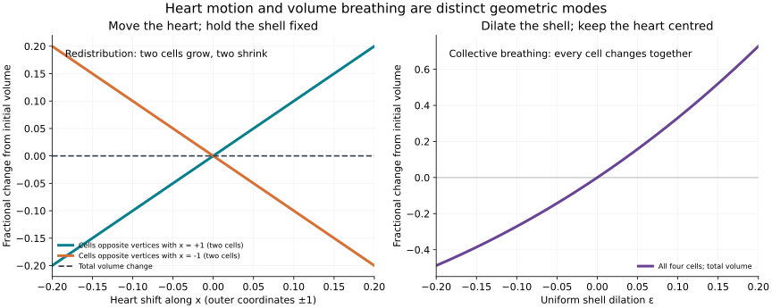

# Heart–shell modes and geometric breathing — v1.0

Status: EXACT within the specified models; physical use remains HYPOTHESIS/OPEN. This work executes the requested derivation of collective and differential modes. It distinguishes chain amplitudes, geometric displacements/volumes and a separately assumed scalar port model.

## 1. Carrier, conventions and readouts

K has maximal tetrahedra [0123],[0124],[0134],[0234], where vertex0 is the shared heart. Its chain counts are (5,10,10,4), dimension29. Use real chain coordinates, ascending simplex orientations, unit metric H=I, and skew generator A with B_k in upper adjacent-grade blocks and -B_k^T below. Evolution is dz/du=A z for dimensionless u. Unless specified, initial states are arbitrary and no external drive or damping is imposed. The finite full-complex operator is retained; no face boundary coordinates are deleted. Norm-squared is conserved, but is not identified with physical energy or positive stock.

Readouts are typed: (a) coordinate at heart vertex; (b) outer vertex amplitudes; (c) oriented cell amplitudes. They are not positions, volumes or probabilities. Geometry in section5 uses an explicit independent Euclidean realization. Section6 introduces an alternative scalar dynamics, not a source-derived replacement for A.

Sources: [previous four-cell calculation](../four-cell-tetrahedron/README.md) and [K5 interpretation](../k5-four-cell/README.md), repository revision 3689f3eda8c3d9db06069af2e09b723fa4aa65f7. The supplied historical ledger v0.39 Q144–Q145, Q151–Q152 and Q157–Q160 distinguishes micro precursors from coarse breathing/readout and constitutive laws; this calculation does not promote a geometric or amplitude mode to that source-defined breathing state. No empirical target or fitted parameter is used.

## 2. Exact heart–shell collective pair

Let e0 be the heart vertex basis vector, e_i the outer vertex basis vectors, and e_0i the oriented outward spoke basis vectors. Define

$$s=e_0+\sum_{i=1}^4e_i,\qquad q=4e_0-\sum_{i=1}^4e_i,\qquad r=\sum_{i=1}^4e_{0i}.$$

Direct boundary multiplication gives

$$As=0,\qquad Aq=5r,\qquad Ar=-q,\qquad Ae_0=r.$$

Norms are ||s||^2=5, ||q||^2=20, ||r||^2=4; these vectors are mutually orthogonal. For Q=q/sqrt(20), R=r/2, the normalized block obeys A Q=sqrt(5)R and A R=-sqrt(5)Q. Thus there is a heart-visible collective oscillator of angular frequency sqrt(5), plus a static uniform component. The coefficient5 comes from the four-spoke divergence and the four-versus-one vertex contrast, not a fitted physical constant.

For initial state z(0)=e0, the full exact solution is

$$z(u)=\frac{s}{5}+\frac{q}{5}\cos(\sqrt5\,u)+\frac{r}{\sqrt5}\sin(\sqrt5\,u).$$

Consequently

$$h(u)=\frac{1+4\cos(\sqrt5\,u)}5,\qquad x_i(u)=\frac{1-\cos(\sqrt5\,u)}5\quad(i=1,2,3,4).$$

Every spoke has amplitude sin(sqrt(5)u)/sqrt(5). All four outer vertices respond equally. The weighted vertex sum h+4x_i remains1, and total chain norm-squared remains1. Negative heart amplitude is permitted: it is not a positive stock or geometric volume. The heart-only readout has a return period2*pi/sqrt(5) in u although the full arbitrary-state29-dimensional model lacks a universal nonzero period.

The heart-generated cyclic subspace span{A^n e0:n>=0} is exactly span{s,q,r}, dimension3. All face and cell coordinates remain identically zero. Since A is skew, the heart-only continuous-time readout has the same observability rank3; its unobservable subspace has dimension26. This is a linear observability statement, not a percentage of physical information. The chain model therefore supports collective vertex/edge oscillation but does not by itself turn a heart-vertex excitation into a cell-volume breathing motion.

## 3. Shell differential and cell modes

For any outer vertex contrast w=sum_i a_i e_i with sum_i a_i=0, A^2w=-5w. There are three independent contrasts. Both w and Aw have zero heart readout: these are heart-dark differential modes at sqrt(5).

Use coherent oriented top-cell basis vectors t_i (one per cell) with signs (-1,+1,-1,+1) in the ascending listed-cell order. Their face Gram matrix is

$$\langle A t_i,A t_j\rangle=(5I-J)_{ij},$$

where J is the4x4 all-ones matrix. With t=sum_i t_i and f=A t, internal triangular contributions cancel, leaving the outer shell cycle. Exactly

$$At=f,\qquad Af=-t,\qquad \|t\|^2=\|f\|^2=4.$$

This is a collective oriented cell/shell-face oscillator at frequency1. For a cell contrast d=sum_i a_i t_i, sum_i a_i=0, A^2d=-5d. The three independent cell contrasts give three differential oscillator copies at sqrt(5).

| Family | Oscillator copies | Angular frequency in u | Heart readout |
| --- | --- | --- | --- |
| Heart–shell vertex/spoke collective | 1 | sqrt(5) | Visible |
| Outer vertex contrasts | 3 | sqrt(5) | Zero |
| Coherent cell/outer-face cycle | 1 | 1 | Zero |
| Cell contrasts | 3 | sqrt(5) | Zero |

This is not a full enumeration of29 coordinates: the constant mode contributes1 coordinate, the displayed8 oscillator copies contribute16, and a further6 edge–face oscillator copies contribute12 (all at sqrt(5), from rank B2=6). The displayed families are selected for the named question.

The cell oscillator subspaces contain only grades2/3; the heart oscillator contains grades0/1. They are mutually orthogonal invariant subspaces. Same frequency does not produce coupling between orthogonal blocks.

## 4. Why the heart does not automatically pump cell amplitudes

The obstruction is exact boundary composition: B2^T B1^T=(B1 B2)^T=0. A heart-vertex seed enters the edge space through im(B1^T); it cannot continue into faces via B2^T. Similarly B2 B3=0 isolates top-cell/face oscillators from vertex/edge ones.

This is not repaired merely by choosing consistent positive grade metrics. With metric adjoints, B2^dagger B1^dagger=(B1 B2)^dagger=0; the vertex plus exact-edge subspace remains invariant for the corresponding chain skew law. Arbitrarily changing independent incidence weights can change that result but requires a newly defined operator and fresh boundary/metric checks. Nonlinear or extra constitutive couplings are different hypotheses.

There is also an orientation distinction. Under all24 outer-vertex permutations, the heart basis vector is a scalar, while the coherent oriented top-cell sum transforms by the permutation sign. A linear S4-equivariant direct map between those particular one-dimensional representations is zero. A physical unsigned volume is not automatically an oriented C3 amplitude; a density/readout convention must be stated. These facts constrain the assumed linear model, not every possible physical heart–shell dynamics.

## 5. Exact geometry: a displaced heart redistributes volume

Use dimensionless reference positions r1=(1,1,1), r2=(1,-1,-1), r3=(-1,1,-1), r4=(-1,-1,1). Keep the outer vertices fixed and place the heart at h inside their convex hull. The parent volume is V=8/3 in reference length units cubed. Since r_i dot r_i=3 and r_i dot r_j=-1 for i!=j, the barycentric coordinates and child volumes are exactly

$$\lambda_i(h)=\frac{1+r_i\cdot h}{4},\qquad V_i(h)=V\lambda_i(h).$$

Here V_i labels the cell opposite outer vertex i; its order differs from the drawing's Cell1–Cell4 labels. For any displacement remaining inside the fixed shell,

$$\delta V_i=\frac V4\,r_i\cdot\delta h,\qquad\sum_i\delta V_i=0.$$

The4x3 volume Jacobian has rank3 and image the zero-sum volume contrasts. Thus heart displacement spans the three differential volume modes and has no uniform-volume component. This is exact for the fixed shell, not merely infinitesimal, because barycentric volume is affine in h. It is a kinematic identity; no mechanical equation of motion is implied.

For comparison, dilate the outer positions r_i -> (1+epsilon)r_i while keeping h=0. Then

$$V_i(\epsilon)=\frac V4(1+\epsilon)^3,\qquad \delta V_i=\frac{3V}{4}\epsilon+O(\epsilon^2).$$

All four cells change together: this is genuine geometric collective volume breathing. Under this imposed dilation, heart position remains fixed. Geometry alone supplies neither a restoring force nor a pumping/synchronization law. A conserved sum of cell volumes is not a conserved physical energy.

## 6. Separate candidate: an internal scalar heart with four scalar ports

To demonstrate what an added coordinating law would look like, assume a different state (q0,q1,...,q4) with unit model inertia and potential

$$U=\frac\alpha2\sum_{i=1}^4(q_i-q_0)^2+\frac\beta2\sum_{1\le i<j\le4}(q_i-q_j)^2,\quad \alpha>0,\ \beta\ge0.$$

q0 is an internal scalar heart coordinate, not its3D displacement. The q_i are scalar port coordinates; their geometric readout remains OPEN. State is (q,qdot) in R10; dynamics is qddot=-L q with L the Hessian of U, arbitrary initial state, no boundary drive/damping. alpha and beta have model inverse-u-squared units for these unit-inertia conventions. No numerical value or ledger ratio is imported. This is a chosen conservative toy law, not a fit, native UD derivation or uniquely selected material model.

For x=(sum_i q_i)/4, d_i=q_i-x, eta=q0-x and Q=(q0+4x)/5, exact equations are

$$\ddot\eta+5\alpha\eta=0,\quad\ddot d_i+(\alpha+4\beta)d_i=0,\quad\sum_i d_i=0,\quad\ddot Q=0.$$

One relative collective mode has omega^2=5alpha; three differential modes have omega^2=alpha+4beta. Their ratio is sqrt(5alpha/(alpha+4beta)), not universal. At alpha=beta all four nonzero modes are degenerate, so the bare equal-coupling K5 does not spectrally distinguish a preferred heart. At beta=0 the star law still has a collective/differential split; outer edges alone do not explain its existence. Varying beta at fixed alpha changes differential frequencies while leaving the relative collective frequency fixed, a conditional discriminant.

The uniform Q mode is free; arbitrary initial Qdot yields drift, not an oscillator. Holding Q fixed needs Qdot(0)=0 (or a new pinning law). Energy1/2||qdot||^2+U is conserved. There is no attraction, autonomous pump, selected sustained amplitude or damping. Calling the collective port mode a geometric breathing mode requires a declared map to moving shell positions plus appropriate equilibrium/restoring terms; it is not established by this potential alone.

## 7. Verification and next discriminant

Run `python3 experiments/heart-shell-modes/analyze.py`. Its constructor checks use integer matrices/Fraction elimination: exact mode identities, heart cyclic rank, absent face/cell transfer, all24 orientation-character checks, the cell Gram matrix, barycentric volumes at declared rational points, a rank3 volume Jacobian, dilation identities, and separate coefficient-matrix identities proving the scalar port formulas for arbitrary alpha,beta. The report supplies algebraic proofs beyond sampled examples. No numerical eigensolver or physical measurement is used. `draw.py` samples the exact volume formulas for illustration; it requires matplotlib/numpy and is not proof.

Next: choose a scalar internal heart variable and an explicit shell displacement/volume readout. Derive a positive energy or constitutive law with equilibrium, forcing and (if claimed) damping, then test whether it drives the uniform volume mode while preserving the three redistribution modes. Source-defined UD breathing/stock variables and physical time remain separate bridges.
