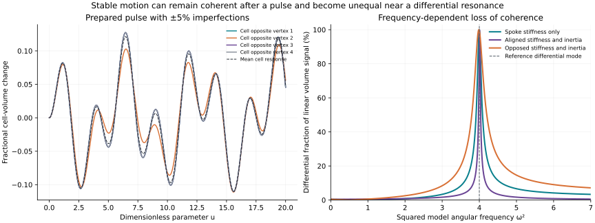

# Heart–shell robustness under unequal spokes and inertias — v1.0

Evidence: EXACT/CONDITIONAL stability and shape identities; NUMERICAL finite-window scan; model selection remains HYPOTHESIS. This executes the requested imperfection test of the [positive-energy heart-to-volume model](../heart-shell-elastic/README.md). No material identification or mainline promotion follows.

## 1. Model and declared perturbations

Retain an internal heart strain a, four radial shell strains q_i, a fixed centre, and R_i=(1+q_i)r_i with q_i>-1. The opposite-vertex cell volumes are exactly V_i=V0*product_(j!=i)(1+q_j)/4. State is (a,q,a',q') in R10 and u is dimensionless.

Replace the uniform spoke stiffness K_c by g_i>0 and the four shell inertias by m_i>0. Keep K_h=K_s=I_h=1 and K_t=1/2 in the declared model units. The chosen energies are

$$T=\frac12(a')^2+\frac12\sum_i m_i(q_i')^2,$$

$$U=\frac12a^2+\frac12\sum_i q_i^2+\frac12\sum_i g_i(q_i-a)^2+\frac14\sum_{i<j}(q_i-q_j)^2.$$

No damping or external drive is present in the pulse scan. Harmonic shape analysis below separately considers an externally sustained heart amplitude or a normal-mode shape. The energies, radial readout and parameter family are assumed models, not source-derived material laws. Source base is2b2e69de470d52f888c6926279ae2dd964ece769.

## 2. Exact stability survives disorder

Every term of U is nonnegative, and the fixed positive onsite terms make U positive definite for every positive g_i. All positive m_i make T positive definite. Energy conservation therefore gives Lyapunov stability and bounded unforced trajectories without requiring S4 symmetry. Coherence of the four cell signals is a separate question.

The prepared pulse has a(0)=1/10, all q_i(0)=0 and all velocities0. For g_i in[0.8,1.2], its energy satisfies E0=(1+sum_i g_i)/200<=29/1000<1/2. Since U>=sum_i q_i^2/2, |q_i|<=sqrt(2E0)<1 for all u. Thus every case in the declared parameter box remains inside the noncollapsed geometric domain for all unforced model times. This bound is general; the numerical scan is not being used to infer it.

## 3. Exact equation showing how asymmetry generates differences

Let b=(sum_i q_i)/4, d_i=q_i-b, P=I-J/4, gbar=(sum_i g_i)/4 and mbar=(sum_i m_i)/4. Write delta g=g-gbar*1 and delta m=m-mbar*1. In a harmonic component with squared angular frequency lambda, define

$$D_{\rm diff}^{(0)}=1+\bar g+2-\lambda\bar m,\qquad H_d=P\,\mathrm{diag}(3+g_i-\lambda m_i)P\big|_{\sum d_i=0}.$$

Projecting the exact shell equations onto the zero-sum subspace gives

$$\boxed{H_d d=\delta g\,(a-b)+\lambda\,\delta m\,b.}$$

Spoke disorder responds to the relative heart/shell strain; inertia disorder responds to acceleration. Their patterns can reinforce or cancel. A generic small perturbation gives an O(epsilon) differential response away from a differential resonance, not an automatic change in stability.

For rho=max_i|delta g_i-lambda*delta m_i|, the perturbation of the reference differential scalar times I on the differential subspace has operator norm at most rho. If |D0|>rho, the inverse exists and the exact bound is

$$\|d\|\le\frac{\|\delta g\|\,|a-b|+|\lambda|\,\|\delta m\|\,|b|}{|D_{\rm diff}^{(0)}|-\rho}.$$

This bound uses the actual harmonic a,b; it is not a universal gain bound from applied force. It identifies why a small-perturbation estimate loses control near the differential band. Normalizing by b requires b!=0; an absolute bound remains meaningful when the mean response is zero.

## 4. Closed-form two-group imperfection law

For the balanced pattern s=(1,1,-1,-1), take g_i=1+epsilon*s_i, m_i=1+eta*s_i and q_i=b+s_i*d. Direct elimination of a gives the exact harmonic shape ratio

$$\boxed{\frac db=\frac{\epsilon(1-\lambda)+\lambda\eta}{4-\lambda-\epsilon^2+\epsilon\lambda\eta}.}$$

Its first-order form is [epsilon*(1-lambda)+lambda*eta]/(4-lambda), away from the denominator's zero. For the small-signal cell-volume changes y_i=delta V_i/(V0/4)=3b-s_i*d, define R_V=|d|/(3|b|). This is differential RMS amplitude relative to collective RMS amplitude, not the pulse metric in section6.

At the exposed reference upper collective frequency lambda=6:

| Imperfection | epsilon | eta | Exact R_V | Approximate percent |
| --- | --- | --- | --- | --- |
| Spoke stiffness only | 1/20 | 0 | 100/2403 | 4.16% |
| Shell inertia only | 0 | 1/20 | 1/20 | 5.00% |
| Aligned patterns | 1/20 | 1/20 | 4/477 | 0.84% |
| Opposed patterns | 1/20 | -1/20 | 220/2421 | 9.09% |

These are exact shapes at the stated reference frequency, not claims that the perturbed natural frequency remains6 or that its forced amplitude is finite at every pole. No physical frequency is inferred. The bounded fraction of the harmonic volume signal in differences is L_h=|d/b|/sqrt(9+|d/b|^2); it tends to1 when the collective mean becomes negligible.

## 5. Protected mode and a resonance counterexample

With equal unit inertias and equal unit onsite stiffnesses, the in-phase vector (a,q_1,...,q_4)=(1,1,1,1,1) remains an exact lambda=1 normal mode for arbitrary positive spoke stiffnesses. All difference springs are unstrained in that vector. This protects one modal component of a heart preparation, not the entire prepared pulse.

More generally an in-phase vector is exact if all onsite stiffness/inertia ratios equal the same omega0 squared: K*1=omega0^2*M*1 because the graph-Laplacian couplings annihilate1. Matching onsite stiffness to inertia is therefore a possible passive design condition; it is not a native UD selection rule.

Conversely, take eta=0, epsilon>0 and lambda=4, the symmetric model's formerly heart-dark differential frequency. The exact shape formula gives d/b=3/epsilon and R_V=1/epsilon. At epsilon=1/20, R_V=20 and the differential fraction L_h=20/sqrt(401), approximately99.88%.

This does not require a large or invalid geometric amplitude. Choose the externally sustained heart amplitude a=epsilon^2; at lambda4 the exact solution has b=a, d=3epsilon and heart force amplitude F_h=-15epsilon^2. All shell strains approach0 as epsilon approaches0, but the coherent mean shrinks faster than the differential component. It is a forced small-signal counterexample to a uniform all-frequency coherence guarantee, not an instability of the unforced positive-energy system. At genuine undamped poles a bounded stationary forced response is not available.

For the balanced pattern, eta=5epsilon/6 instead preserves a uniform lambda6 shape exactly. This explicitly targets the exposed reference upper mode and is a target-informed design (FIT/design), not independent predictive evidence. It does not simultaneously preserve the lambda1 mode with the current equal onsite pins: preserving both requires epsilon=eta=0 within this restricted pattern family.

## 6. Finite-window pulse scan and readout metric

Use the same prepared pulse as section2. For each epsilon in{1/100,1/20,1/10,1/5}, enumerate all256 choices g_i=1+epsilon*s_i and m_i=1+epsilon*t_i with s_i,t_i independently in{-1,+1}. These are all corners of the declared relative-variation box, not a proof of the worst case inside that box.

Compute exact modal time evolution numerically by diagonalizing M^(-1/2) K M^(-1/2) in float64. This avoids ODE integration error; numerical eigenvectors, cosine evaluation and quadrature still carry approximation error. Use u in[0,100] with4001 samples, and also report[0,20]. The readout is the exact nonlinear fractional cell-volume signal y_i=product_(j!=i)(1+q_j)-1. Define

$$\mathcal L_V=\sqrt{\frac{\int\|P y(u)\|^2\,du}{\int\|y(u)\|^2\,du}}.$$

This is the RMS nonuniform volume-signal fraction. It is neither a fraction of physical energy nor lost information. The denominator is nonzero for the prepared pulse. Percentages below are100*L_V, not100*(1-L_V) coherence. The orthogonal uniform signal accounts for1-L_V^2 of integrated squared signal, not1-L_V.

| Maximum relative variation in each spoke/inertia | Tested corners | Largest observed L_V, u=0..100 |
| --- | --- | --- |
| 1% | 256 | 1.88% |
| 5% | 256 | 9.35% |
| 10% | 256 | 21.25% |
| 20% | 256 | 40.68% |

The5% maximum occurs for one outlying spoke opposed by its inertia pattern, up to vertex permutation. An additional256 seeded interior points at5% (seed4307) gave largest observed L_V=6.07% and median2.82%. This is a deterministic computational probe, not a confidence interval or a proof that corners exhaust the continuous-box extrema. No experimental acceptance threshold was preregistered; the task is quantification, not an empirical pass/fail claim.

## 7. Numerical and exact verification

Run `OPENBLAS_NUM_THREADS=1 python3 experiments/heart-shell-robustness/analyze.py --out OUTPUT_DIRECTORY`.

The constructor exact-arithmetic checks use Fraction elimination for20 balanced shape cases, the general projected differential identity, protected-mode examples, the compensation design and the lambda4 counterexample. The report derives the general formulas and stability proof.

The numerical scan uses NumPy2.3.5 float64. Across1024 corner trajectories, maximum relative energy residual was4.23e-15 and the smallest observed squared frequency was0.861. A separately implemented short-time10x10 exponential power series agreed with the modal propagation to2.78e-17 in the selected cross-check. These are constructor implementation checks, not independent replication.

For each observed worst corner, rerunning the quadrature with8001 and16001 points changed L_V by at most8.26e-8 between the two finer grids, supporting the table's displayed precision for those cases. This is not an error bound on the unsampled continuous parameter region, other preparations, arbitrary driving or unlimited times.

`summary.json` and `corner-scan.csv` are captured in the owning run manifest. `draw.py --summary SUMMARY_PATH` generates the figure. Left: exact nonlinear volume readout of the5% observed worst-pattern pulse over0..20. Right: exact small-signal harmonic projection fractions for the balanced patterns. The panels use distinct experiments/readouts, explicitly labelled.

Provenance: [preceding model](../heart-shell-elastic/README.md), source revision2b2e69de470d52f888c6926279ae2dd964ece769; historical [ledger v0.39](../../sources/imports/2026-10-22/UD_COEFFICIENT_PROVENANCE_LEDGER_v0.39.md), Q139,Q144-Q145,Q151-Q152, retains native-constitutive and physical-clock boundaries. Model parameters remain assumed; no frozen source status is amended. [Candidate/receipt](../../candidates/heart-shell-robustness/candidate.json) records assumptions, targeted design and scope.

Next discriminant: derive a passive damping requirement and a usable drive-frequency band that suppress differential resonance while preserving a measurable collective volume response. Compare it with the matched-onsite-ratio option before proposing a material realization.
